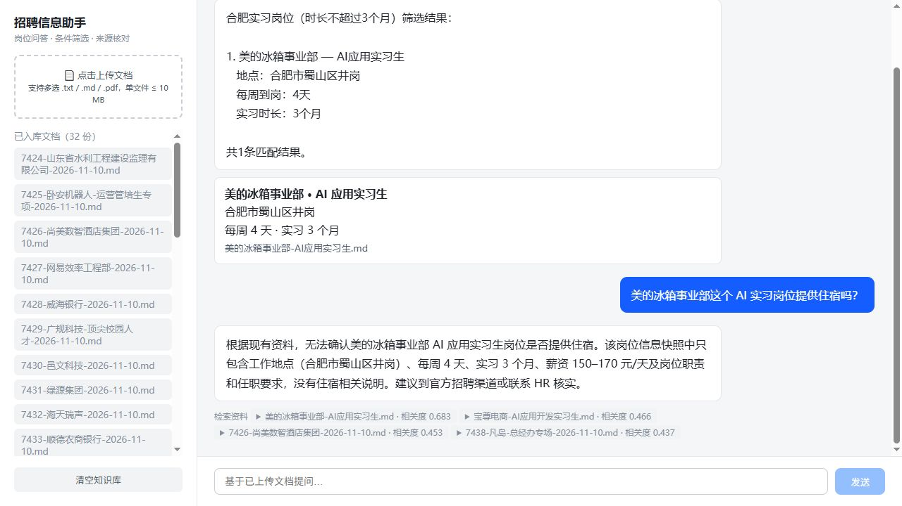
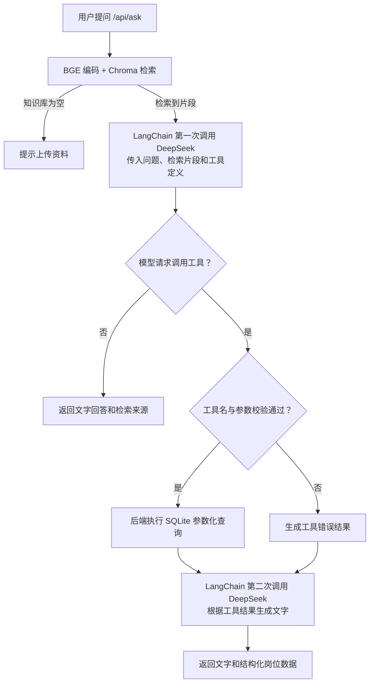

<p align="center">
  
</p>

<p align="center">
  <strong>从一份招聘资料，到一个有依据的回答。</strong><br />
  基于 RAG 与工具调用的招聘信息助手 · Vue + FastAPI + LangChain + LangGraph
</p>

<p align="center">
  
  
  
  
  
  <a href="LICENSE"></a>
</p>

<p align="center">
  <a href="#演示效果">演示效果</a> ·
  <a href="#快速开始">快速开始</a> ·
  <a href="#工作原理">工作原理</a> ·
  <a href="#验证结果">验证结果</a> ·
  <a href="docs/项目交付说明.md">完整项目说明</a>
</p>

---

## 这个项目能做什么

招聘信息散落在截图、公告和岗位描述中。这个项目把整理后的资料导入知识库，让用户用自然语言查询要求、比较公司，以及筛选满足条件的招聘记录。

| 场景 | 你可以这样问 | 系统怎样处理 |
| --- | --- | --- |
| **岗位详情** | 睿联技术的嵌入式软件岗在哪个城市，招哪一届？ | 检索资料，由模型整理答案，附可展开的原文片段 |
| **公司对比** | 美的和宝尊的 AI 实习，每周几天、实习多久？ | 结合指定公司的检索片段，汇总差异 |
| **条件筛选** | 筛选合肥的实习，实习时长不超过 3 个月 | 模型调用 `search_jobs`，后端执行 SQLite 参数化查询 |
| **信息缺失** | 美的这个岗位提供住宿吗？ | 提示资料未说明或无法确认，避免凭空补全 |

同时支持多文件上传、同名文件更新、结构化结果卡片，以及带确认的知识库清空。

> **当前版本的数据范围**：32 份手工整理的招聘资料，包括 30 份招聘公告快照和 2 份实习说明。一份公告可能包含多个岗位，不等于一条独立岗位。尚未导入在线表格中的 7000 多条数据，也未实现自动采集或定时同步。

`samples/` 保存可供导入的 Markdown 原始资料；上传后，系统会实际生成本地 Chroma 向量索引及 SQLite 结构化索引。仓库不附带已生成的数据库，新克隆项目需先上传资料。数据来源、入库流程和更新方式见[数据说明](docs/数据说明.md)。

## 演示效果

下图来自本地应用的真实运行：条件筛选返回美的岗位，住宿问题提示无法确认，并展示检索来源。



<details>
<summary><strong>展开查看：3 分钟演示顺序</strong></summary>

1. 批量上传 `samples` 下的 32 份 Markdown；如果已经入库，直接提问。
2. 查询睿联技术岗位的城市和招聘届别，展开来源核对。
3. 对比美的与宝尊的实习时长、每周到岗天数。
4. 筛选「合肥、实习时长不超过 3 个月」，查看美的结果卡片。
5. 将时长改为 2 个月，观察无匹配结果。
6. 问「美的提供住宿吗？」，观察缺少依据时的回答。

完整步骤和预期结果见[项目交付说明](docs/项目交付说明.md#3-分钟演示顺序)。

</details>

## 工作原理

上传时，BGE 将文档切片转成向量，Chroma 保存向量与原文片段。符合约定格式的 Markdown 还会建立 SQLite 索引，供岗位筛选使用。

提问时，FastAPI 将请求交给 LangGraph 的 `StateGraph`。图先检索 Chroma，再根据 LangChain 返回的 DeepSeek 消息选择下一步。



- **LangChain** 用 `ChatDeepSeek.bind_tools()` 绑定 `search_jobs` 的定义，通过 `invoke()` 发起模型请求。
- **LangGraph** 用条件边处理空知识库、普通问答和工具调用。工具分支只执行一轮，第二次模型请求设置 `tool_choice="none"`。
- **后端** 用 Pydantic 严格校验参数，再查 SQLite。第二次模型请求使用用户问题和工具调用记录、工具结果。Vue 根据后端返回的结构化岗位数据渲染卡片。

流程节点和条件边见 [app/rag.py](app/rag.py)。

| 层级 | 使用的技术 | 作用 |
| --- | --- | --- |
| 页面 | Vue 3 · TypeScript · Vite | 上传、问答与结果展示 |
| 接口 | FastAPI · Pydantic | 请求处理、字段校验与前端托管 |
| 检索 | 本地 BGE · Chroma | 中文文本向量化与语义召回 |
| 筛选 | SQLite | 城市、关键词、类型、实习月数及出勤天数上限筛选 |
| 生成 | LangChain · DeepSeek | 绑定工具定义，调用模型回答和整理结果 |
| 编排 | LangGraph | 管理检索、问答与工具分支 |

<details>
<summary><strong>展开查看：关键实现参数</strong></summary>

- Embedding 模型：`BAAI/bge-small-zh-v1.5`，本地运行，CLS 向量 + L2 归一化。
- 切片：目标 400 字符，重叠 80 字符，优先在换行处切开；不是按 token 切片。
- 检索：余弦距离，最多返回 4 个片段。相关度 `1 - distance` 不是答案正确概率。
- 工具参数：Pydantic 校验，固定查询模板与参数绑定；没有让模型直接执行任意 SQL。
- 时长与天数：上限包含边界；资料未注明时使用 `NULL`，不会当作 0。
- 生成模型：默认 `deepseek-flash`，可通过 `.env` 配置兼容当前工具调用格式的模型。

</details>

## 快速开始

**已验证环境：Windows · Python 3.12 · Node.js 24.14.0。** 需要安装 [uv](https://docs.astral.sh/uv/getting-started/installation/) 和满足 [Node 版本要求](frontend/package.json) 的 Node.js，并准备可用的 DeepSeek API Key。

### 1. 配置 API

在项目根目录将 `.env.example` 复制为 `.env`，填入自己的密钥。已有 `.env` 时保留原文件。

```dotenv
DEEPSEEK_API_KEY=your_deepseek_api_key
DEEPSEEK_MODEL=deepseek-flash
```

密钥仅由后端读取，`.env` 已加入 Git 忽略列表。BGE 在本地向量化；问答时，问题和检索片段或工具结果会发送给 DeepSeek。

### 2. 安装与构建

在项目根目录打开 PowerShell，依次运行：

```powershell
uv venv --python 3.12
uv pip install --python .\.venv\Scripts\python.exe -r requirements-lock.txt
npm.cmd --prefix frontend ci
npm.cmd --prefix frontend run build
```

已有虚拟环境时跳过第一行。更新旧版本后，重新执行 Python 依赖安装命令，再重启服务。Python 和前端依赖分别记录在 `requirements-lock.txt` 和 `package-lock.json`。

### 3. 启动与使用

```powershell
.\start.cmd
```

看到 `Application startup complete` 后，打开 **[http://127.0.0.1:8000](http://127.0.0.1:8000)**，多选上传 [samples](samples) 中的资料，即可提问。首次启动需要下载并加载 BGE 模型。

日常可以直接双击 `start.cmd`，保持终端开启，按 `Ctrl+C` 停止。修改前端后需重新构建并重启服务。

<details>
<summary><strong>展开查看：开发模式与常见问题</strong></summary>

- 前端开发：后端运行时，另开终端执行 `npm.cmd --prefix frontend run dev`，Vite 将 `/api` 请求代理到 8000 端口。
- API 文档：服务启动后访问 [http://127.0.0.1:8000/docs](http://127.0.0.1:8000/docs)。
- 找不到 `uv`：可使用已安装 uv 的系统 Python 执行 `python -m uv` 替代。
- 网页打不开：确认终端未关闭且服务启动完成；8000 已被占用时不要重复启动。
- 文件无法解析：TXT / Markdown 使用 UTF-8；PDF 必须含可提取文字，扫描版需要先 OCR。
- 页面未更新：重新构建并重启后端，再按 `Ctrl+F5` 刷新浏览器。
- 更多排查：[常见故障](docs/项目交付说明.md#常见故障)。

</details>

## 验证结果

离线测试、真实问答和前端构建于 **2026-11-13** 在 LangChain / LangGraph 版本复验。页面验收来自 **2026-11-11**。这些检查用于功能验收。

| 检查 | 结果 | 覆盖范围 |
| --- | --- | --- |
| 离线自动化测试 | **13 项通过** | 边界筛选、同名更新、重启与清空、异常处理、工具参数校验等 |
| 真实 DeepSeek 问答 | **5 个场景通过** | 单公司查询、公司对比、信息缺失、条件筛选、无匹配结果 |
| 前端检查 | **通过** | TypeScript 类型检查与 Vite 生产构建 |
| 页面验收 | **通过** | 结果卡片、来源展开、清空确认与取消 |

```powershell
# 离线测试 + 前端检查与构建，不调用付费 API
.\verify.cmd

# 服务已启动且样例已导入时执行；会消耗正常 API 额度
.\.venv\Scripts\python.exe scripts\evaluate_demo.py
```

运行上述评估脚本后，真实问答报告保存在本地 `data/reports/demo-evaluation.json`。离线测试使用临时数据库和替代模型，不改动日常知识库。详细说明见[验收记录](docs/项目交付说明.md#验收结果)。

## 仓库导航

```text
job-search-assistant/
├── app/                    # FastAPI、RAG 与 SQLite 筛选
│   ├── main.py
│   ├── rag.py
│   ├── jobs.py
│   └── static/             # 上游 HTML 页面，未构建 Vue 时的回退入口
├── frontend/               # Vue 3 + TypeScript 前端
├── samples/                # 32 份整理后的招聘资料，上传后入库
├── tests/                  # 离线回归测试
├── scripts/                # 真实问答验证脚本
├── docs/
│   ├── assets/             # 当前封面与演示截图
│   ├── archive/            # 上游历史说明与演示
│   ├── 数据说明.md           # 来源、导入方式与数据范围
│   └── 项目交付说明.md       # 架构、演示、验收与能力边界
├── data/                   # 本地生成的数据，不提交 Git
├── .env.example            # 配置模板
├── requirements*.txt       # 直接依赖、测试依赖与版本快照
├── start.cmd               # 日常启动
└── verify.cmd              # 本地验证
```

## 当前边界

- 本机单进程演示应用，未实现登录、多用户隔离或公网部署。
- 页面保留当前会话的消息，但后端未实现多轮记忆；刷新后聊天记录消失。
- 结构化筛选只解析约定格式的 Markdown；TXT / PDF 用于语义问答。
- 来源展示的是检索候选片段，尚未进行逐句引用验证；拒答效果依赖检索和模型，不能保证零幻觉。
- 招聘资料为快照，多岗位、多城市公告不保证一一对应；投递前需核实官方信息。
- 清空会删除当前索引，保留上传原文件；重启不会自动恢复已清空的资料。

## 开源来源与改造

本项目基于 **[Sunruising/rag-knowledge-base-qa](https://github.com/Sunruising/rag-knowledge-base-qa)** 改造，保留 [MIT 许可证](LICENSE) 与原作者署名。

| 上游提供 | 本仓库的主要改造 |
| --- | --- |
| 基础上传、切片、BGE、Chroma 与 DeepSeek 问答 | 招聘资料整理及结构化字段索引 |
| 原生 HTML 页面 | Vue / TypeScript 迁移与批量上传 |
| 基础检索结果展示 | 工具调用筛选、结果卡片、来源展开及异常提示 |
| Python 问答流程 | 用 LangChain 接入 DeepSeek，并以 LangGraph 编排检索、分流与结果生成 |
| 基础运行示例 | 回归测试、真实问答验证、启动脚本与交付文档 |

实现过程中使用 AI 辅助。[上游历史说明](docs/archive/README.upstream.en.md)仅用于保留来源记录；当前功能与运行方式以本 README 为准。
