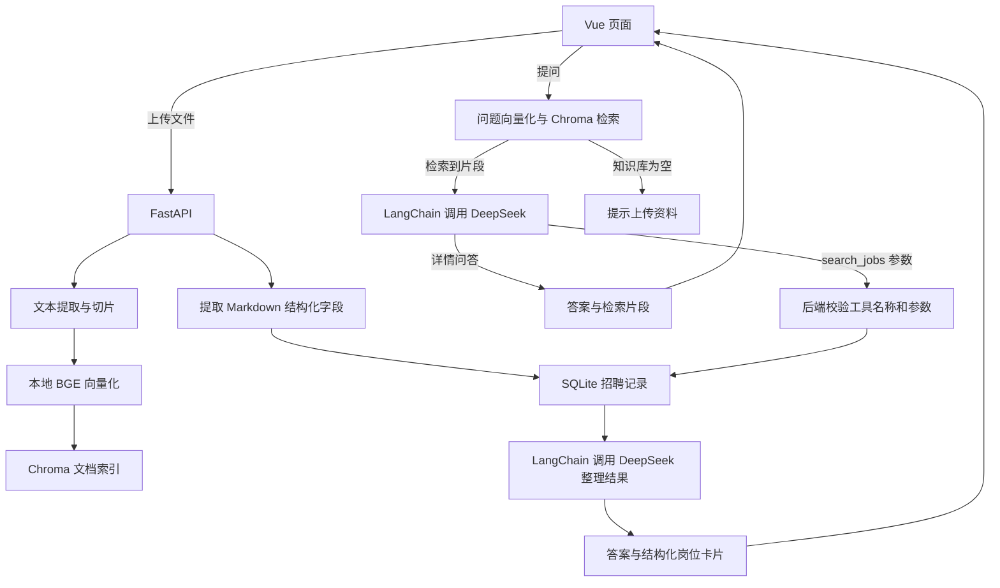

# 招聘信息助手 v1.0 — 本地演示交付

验收日期：2026 年 11 月 11 日。

## 项目解决什么问题

将分散的招聘资料整理进知识库，支持公司岗位问答、指定公司要求对比，以及城市、实习时长、每周出勤天数等条件筛选。当前样例为 30 份招聘公告快照与 2 份实习说明，共 32 份文档。没有导入原始在线表格中的 7000 多条数据，也不自动更新招聘状态。

## 架构与代码入口



| 文件 | 职责 |
| --- | --- |
| `frontend/src/App.vue` | 页面状态、批量上传、问答、来源展开、筛选卡片、清空确认 |
| `app/main.py` | 请求校验、上传与清空协调、服务生命周期、静态页面托管 |
| `app/rag.py` | 切片、BGE、Chroma、LangChain 模型调用与 LangGraph 问答编排 |
| `app/jobs.py` | Markdown 字段提取、SQLite 索引及参数化查询 |
| `tests/test_project.py` | 离线回归测试，使用临时数据和替代模型 |
| `scripts/evaluate_demo.py` | 5 个真实 API 问答场景的可重复检查 |

FastAPI 将问答请求交给 LangGraph。图先检索，有结果时通过 LangChain 调用 DeepSeek，再根据模型响应进入普通问答或工具分支。模型和工具定义通过 `ChatDeepSeek.bind_tools()` 连接，图通过条件边选择下一步。`search_jobs` 是一个预先定义的查询函数。大模型生成 JSON 参数，Python 使用 Pydantic 校验，SQLite 执行带占位符的 SQL；模型不能直接执行任意 SQL。工具结果回传后，第二次生成只使用用户问题、工具调用记录和工具结果，并关闭工具调用。前端继续用 SQLite 返回的记录渲染岗位卡片。

## 关键技术选择

- BGE 使用 `BAAI/bge-small-zh-v1.5`，在本地加载；取 CLS 向量并做 L2 归一化，查询带检索指令，单批最多 32 个文本。
- 文本切片目标长度 400 个字符，重叠 80 个字符，优先在后半段换行处切开。字符数不是 token 数，模型输入截断上限为 512 tokens。
- Chroma 使用余弦距离，检索最多 4 段；界面相关度是 `1 - distance`，不是答案正确概率，也没有设置统一拒答阈值。
- SQLite 一份匹配格式的 Markdown 对应一条招聘记录。招聘公告可能包含多个岗位，不能把记录数称为独立岗位数。
- 查询采用固定 SQL 模板与参数绑定。数值上限包含边界，未知时长为 NULL，不会当成 0 个月参与匹配。
- 同名文件更新会替换旧向量，并重建 SQLite 索引；清空、上传协调使用进程内锁，Chroma 查询和集合重建也有锁保护。
- 默认 DeepSeek 模型为 `deepseek-flash`，可以通过 `.env` 中的 `DEEPSEEK_MODEL` 配置；需要模型支持当前工具调用格式。

## 3 分钟演示顺序

1. 双击 `start.cmd`，服务就绪后打开 `http://127.0.0.1:8000/`。若服务已在运行，直接打开网页。
2. 看到左侧 32 份文档即可开始。新环境需多选上传 `samples` 内文件，不需要为演示清空现有资料。
3. 提问「睿联技术的嵌入式软件开发工程师在哪个城市，招哪一届？」。指出答案中的深圳、2027 届，并展开来源核对。
4. 提问「美的冰箱事业部和宝尊电商的 AI 实习岗位，每周分别到岗几天，各实习多久？」。展示两份资料对比。
5. 提问「筛选合肥的实习岗位，实习时长不超过 3 个月」。展示美的卡片及每周 4 天、3 个月。说明这一步实际执行了 SQLite 条件查询。
6. 把上限改为 2 个月，预期当前样例无匹配。
7. 提问「美的冰箱事业部这个 AI 实习岗位提供住宿吗？」。展示资料缺失时说明无法确认。

## 数据格式

结构化筛选识别以下示例格式。没有对应字段应保留缺失，不猜测；TXT / PDF 可以参加语义问答，但不会由当前解析器自动转成 SQLite 招聘记录。

```markdown
# 示例公司｜AI 应用实习生
- 公司：示例公司
- 岗位名称：AI 应用实习生
- 工作地点：合肥
- 到岗要求：每周 4 天
- 实习时长：3 个月
- 来源：招聘截图或公告出处
- 当前招聘状态：未核实
```

当前解析器也识别样例中的「公司 / 部门」「岗位」「招聘岗位」「出勤要求」。仅准确格式的数值字段会解析为数字。复杂时长区间、不明确的岗位和城市映射仍保留原文，需要进一步清洗才能做更细的结构化筛选。

## 验收结果

本次使用 Windows、Python 3.12、Node 24.14.0、Vite 8.3.6。已安装 Python 依赖快照位于 `requirements-lock.txt`，前端依赖使用 `package-lock.json`。

- `verify.cmd`：13 项离线自动化测试通过，Vue TypeScript 检查与生产构建通过。
- 覆盖数值边界、缺失值、SQL 特殊输入、同名更新、清空后重启、空库、损坏文件、大小限制、问题及工具参数校验、缺少密钥、模型超时、切片尾部、来源全文和筛选结果隔离。
- 2026-11-11 22:34 的真实模型检查：5/5 场景通过，分别为单公司查询、两公司对比、缺失信息、条件筛选、无匹配结果；耗时约 1.05–2.51 秒/题，仅为本次观测。
- 真实调用所用现有知识库为 32 份文档、36 个片段。切片修正只对后续上传生效，未为验收重建或删除现有资料。
- 浏览器已核对筛选结果卡片，清空确认窗口可以取消，取消后仍为 32 份资料。
- 浏览器已核对住宿信息缺失时的回答，来源片段可展开查看完整切片；截图见 [演示截图](assets/demo-v1.jpg)。

上述是小规模功能验收，不能等同于大规模准确率、并发性能或所有问法可靠性的结论。真实检查脚本包含模式、关键词和结果行断言，仍需人工阅读完整答案与来源。离线测试替代了 BGE 和 DeepSeek，不用它衡量模型回答质量。

## 已知边界

1. 当前是本机、单进程演示应用，没有登录、权限隔离、限流和公网部署。不要以多 worker 或面向多人生产系统宣传。
2. 未实现多轮对话记忆。页面可显示多条消息，但每次请求只发送当前问题，刷新后聊天消失。
3. Chroma 来源列表是检索到的候选片段，不是逐句验证后的引用；语义相近不代表包含答案。模型拒答仍依赖证据与提示，不能保证绝不幻觉。
4. 城市匹配为原始地点文本包含关系，不是行政区划解析；多岗位多地点公告不能保证岗位与城市一一对应。
5. 支持有限筛选字段，没有任意自然语言转 SQL、自动规划多 Agent、自动投递、在线抓取或实时招聘状态验证。
6. 文档、Chroma 与 SQLite 是三个存储层，进程内锁不是跨库事务；极端磁盘错误和进程中途退出仍可能需要重新上传恢复。
7. 清空只删索引，原始上传文件保留；没有 OCR、模型微调、混合检索或 reranker。这些可以作为后续迭代，不能写成已完成。

## 贡献与表述

上游为 Sunruising/rag-knowledge-base-qa，保留 MIT 许可证和原始作者信息。上游提供基础上传、切片、BGE、Chroma、DeepSeek 问答与 HTML 页面。

本项目在该基础上完成 Vue / TypeScript 迁移、招聘样例整理、批量上传、结构化 SQLite 索引、工具调用筛选、结果卡片、来源展开、异常提示与回归验证。实现过程使用 AI 辅助，不应声称全部从零独立开发。面试准备应围绕自己实际理解、验证和能复现的代码展开。

可用于项目介绍的客观表述：基于开源 RAG 项目改造招聘信息助手，使用 Vue、FastAPI、本地 BGE、Chroma 与 SQLite；通过 DeepSeek 工具调用完成条件筛选，在 32 份招聘资料上完成本地演示和回归验证。

## 常见故障

| 现象 | 操作 |
| --- | --- |
| 网页无法连接 | 启动 `start.cmd`，等待 `Application startup complete`，并保留终端 |
| 8000 被占用 | 已有服务可用时直接访问；需要更新时在原终端 Ctrl+C 后重启 |
| 页面仍是旧版本 | 重新构建前端，重启后端，浏览器 Ctrl+F5 |
| 首次启动模型下载慢 | 首次需下载 BGE；已有缓存但网络检查慢，可在 PowerShell 设置 `$env:HF_HUB_OFFLINE='1'` 后启动；无缓存时不能离线首次加载 |
| DeepSeek 503 配置错误 | 检查根目录 `.env` 是否填写有效密钥，重启；不要把密钥发到聊天或上传 Git |
| DeepSeek 502 | 检查网络、平台余额、密钥和模型配置，稍后重试 |
| 文本无法解析 | TXT / MD 另存为 UTF-8；确认 PDF 完整且不是未识别的扫描件 |
| 条件筛选找不到已上传文件 | 检查是不是符合字段格式的 Markdown，以及数值字段是否缺失 |
